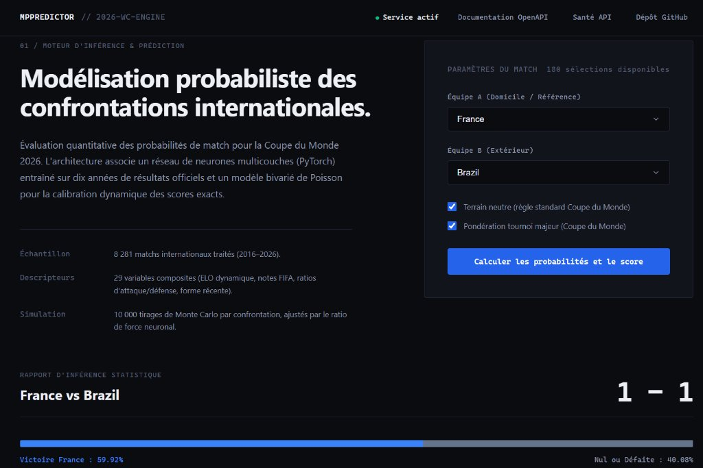

# MPPredictor — World Cup 2026 AI Predictor

Système de prédiction et de modélisation statistique de matchs de football pour la Coupe du Monde 2026, combinant un réseau de neurones multicouches PyTorch et des simulations stochastiques de Monte Carlo (loi bivariée de Poisson).



## Fonctionnalités

- **Modèle Neuronal (PyTorch)** : Réseau feedforward pour estimer la probabilité de victoire d'une équipe selon 29 métriques objectives (ELO, notes FIFA, ratios d'attaque/défense, dynamique récente).
- **Simulation Monte Carlo (Poisson)** : Modèle de Poisson ajusté dynamiquement par le ratio de force neuronal pour simuler 10 000 tirages et déterminer le score modal exact le plus probable.
- **Interface Web Éditoriale** : Application web interactive sans artifice pour configurer et simuler n'importe quelle confrontation parmi 180 sélections.
- **API REST FastAPI** : Endpoint haute performance `/predict` avec schémas OpenAPI et documentation interactive intégrée (`/docs`).

## Installation

### Avec Conda :
```bash
conda activate mppredictor
pip install -r requirements.txt
```

### Avec un environnement virtuel standard (venv) :
```bash
python -m venv .venv
source .venv/bin/activate  # Sur Linux/macOS
pip install -r requirements.txt
```

## Lancement du serveur

Pour démarrer le serveur FastAPI en local :
```bash
uvicorn api:app --reload --host 0.0.0.0 --port 8000
```

Une fois lancé, accédez à :
- **Interface Web interactive** : [http://localhost:8000/](http://localhost:8000/)
- **Documentation OpenAPI (Swagger)** : [http://localhost:8000/docs](http://localhost:8000/docs)
- **Documentation ReDoc** : [http://localhost:8000/redoc](http://localhost:8000/redoc)

## Exemple d'utilisation de l'API

Effectuer une requête POST sur `/predict` :

```bash
curl -X POST "http://localhost:8000/predict" \
     -H "Content-Type: application/json" \
     -d '{
       "team_home": "France",
       "team_away": "Brazil",
       "is_neutral": 1.0,
       "is_world_cup": 1.0
     }'
```

Exemple de réponse :
```json
{
  "match": "France vs Brazil",
  "proba_victoire_home": 59.92,
  "proba_nul_ou_defaite": 40.08,
  "score_predit": "1 - 1",
  "home_goals": 1,
  "away_goals": 1
}
```

## Structure du projet

- `api.py` : Serveur FastAPI, pipeline de normalisation et d'inférence.
- `templates/index.html` : Interface web asymétrique et éditoriale (HTML / CSS sémantique).
- `assets/` : Captures et ressources visuelles du projet.
- `model_match_predictor.pth` : Poids pré-entraînés du modèle PyTorch.
- `modele.ipynb` : Notebook d'entraînement, validation et analyse du modèle.
- `data/processed/` : Données nettoyées et préparées pour l'inférence.
- `data/raw/` : Données historiques brutes des confrontations internationales.
